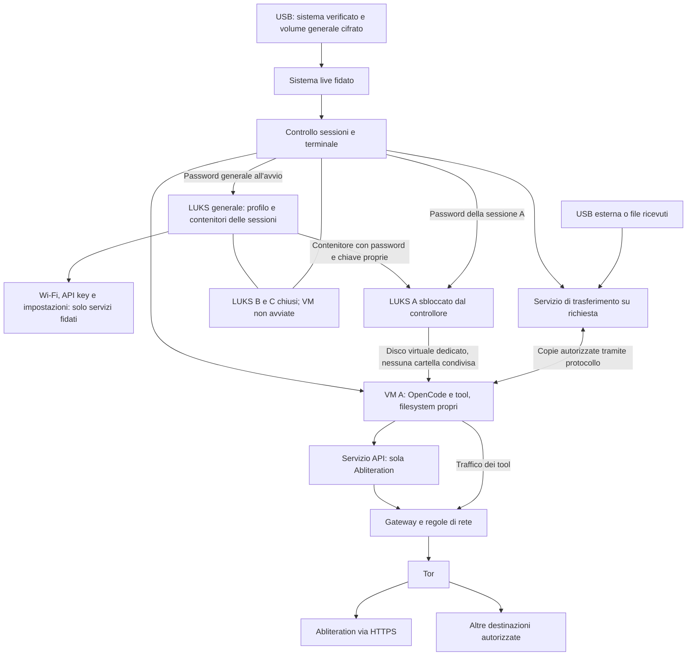

# Oblivion — piano di prodotto e realizzazione

Versione 0.14 — 24 ottobre 2026. Stato: audit iniziale della base OpenCode v2.1.4 completato con inventario, revisione manuale e prove sintetiche riproducibili; implementati il controller Linux con LUKS2 a due livelli, IPC ristretto e ciclo VM dedicato, verificato con guest sintetico in laboratorio. Il primo [profilo privacy compilato](docs/oblivion/PRIVACY-PROFILE.md) ha prove sul binario ARM, ora eseguito anche nel guest con conversazione, tool e riapertura del vault. Il [primo manager fidato](docs/oblivion/MANAGER.md) gestisce password e ciclo VM da TTY, con console filtrata. Lo sviluppo prosegue sul Mac disponibile; KVM su hardware x86 resta un gate di rilascio. La prima TUI ridotta è collegata al manager e provata nel ciclo A→B→A. Le [unità di sistema](docs/oblivion/HOST-SERVICES.md) gestiscono crash del manager/controller e recupero con VM non responsiva nel laboratorio Mac; rifinitura della TUI, resize, guasti durante creazione/shutdown e compatibilità reale Abliteration/Tor restano da collaudare. Non esiste ancora una live Oblivion pronta all'uso. Lo [stato di realizzazione](docs/oblivion/IMPLEMENTATION.md) mantiene i gate ancora aperti; il [report di fase 0](docs/oblivion/phase-0/AUDIT.md) distingue risultati osservati, analisi statica e limiti. Questo documento raccoglie le decisioni della conversazione e la sequenza di implementazione. Lo [studio di networking e trasferimento file](docs/oblivion/NETWORK-AND-FILES.md) distingue le proposte da verificare dai requisiti già concordati.

Oblivion è un ambiente personale per conversazioni private con un agente, con file e cartelle come contesto. È un fork di OpenCode: conserva il motore e i suoi strumenti, inclusa la shell, e adatta la TUI a un prodotto minimale per conversazioni. L'uso principale è conversare, leggere, cercare, elaborare e, quando richiesto, modificare documenti. L'intervento centrale riguarda isolamento, persistenza, rete e ciclo di vita delle sessioni.

**Decisioni già concordate**

| Area                        | Decisione                                                                                                                                                                                      |
| --------------------------- | ---------------------------------------------------------------------------------------------------------------------------------------------------------------------------------------------- |
| Distribuzione               | Debian Live minimale senza ambiente desktop, avviabile da USB. Il sistema operativo installato sul computer non deve essere in esecuzione.                                                     |
| Volume generale             | LUKS2 con password all’avvio; contiene Wi-Fi, API key, impostazioni e i contenitori cifrati delle sessioni. Mai montato nelle VM.                                                              |
| Interfaccia                 | Manager fidato delle sessioni protette e TUI di chat semplificata nel guest; un solo terminale visibile, logo ASCII Oblivion viola all’avvio.                                                  |
| Strumenti                   | Conservare gli strumenti di OpenCode; imporre i limiti con sandbox e gateway, senza sostituire il toolset.                                                                                     |
| Provider                    | Soltanto Abliteration.ai, riutilizzando l'adapter esistente indicato dall'utente.                                                                                                              |
| Sessioni normali            | Persistenti nel volume generale, ciascuna in un proprio contenitore LUKS2 con password e chiave di volume indipendenti.                                                                        |
| Isolamento delle sessioni   | Una VM distinta per sessione, ricreata a ogni apertura, con istanza e server OpenCode propri.                                                                                                  |
| Concorrenza iniziale        | Una sola sessione aperta alla volta. Tutti gli altri volumi di sessione restano chiusi, senza chiavi caricate per l'uso.                                                                       |
| Nessun filesystem condiviso | Nessuna cartella condivisa host/guest o tra VM; nessun database, home, cache o indice comune alle sessioni. I trasferimenti sono copie esplicite di dati.                                      |
| Cifratura                   | Ogni scrittura persistente amministrativa o di sessione viene cifrata durante l’uso; il generale non sblocca automaticamente i volumi interni.                                                 |
| Copertura filesystem        | Ogni percorso scrivibile deve appartenere alla RAM o a un volume cifrato autorizzato; gli altri mount rifiutano le scritture. Comprende `/tmp`, `/var/tmp`, home, cache, log e processi figli. |
| Modalità effimera           | Avvio effimero con generale in sola lettura; dati della sessione solo in RAM; niente contenitore, cronologia o modifica ai profili; credenziali salvate utilizzabili senza aggiornarle.        |
| Tracce locali               | Nessun log applicativo persistente, telemetria o copia in chiaro della sessione su disco. Cache e temporanei confinati.                                                                        |
| Contesto                    | File e cartelle scelti dall'utente. Gli originali non vengono cifrati automaticamente.                                                                                                         |
| Modifiche ai documenti      | Per mantenerle protette, lavorare su copie nel volume della sessione; esportazione esplicita verso altri filesystem.                                                                           |
| Rete                        | Tor come percorso iniziale, gateway locale configurabile per consentire, bloccare o chiedere accesso. Nessuna uscita diretta automatica.                                                       |
| Autorità                    | Le regole di isolamento e di rete sono controllate dall'utente; l'agente non può concedersi nuovi privilegi.                                                                                   |
| Condivisione remota         | OnionShare scelto per inviare e ricevere file tramite Tor, integrato nella TUI in un ambiente dedicato senza filesystem condivisi.                                                             |

**Volume generale e avvio — decisione confermata**

Un volume LUKS2 generale, con propria password richiesta all'avvio, custodisce Wi-Fi, API key Abliteration, impostazioni e regole salvate. Contiene anche i file dei contenitori LUKS2 delle sessioni, ciascuno con password e chiave di volume indipendenti. La password generale apre il profilo e rende disponibili i contenitori ancora cifrati; non apre le chat. Nessuna password o chiave di sblocco delle sessioni viene conservata nel profilo generale. Rimangono una sola sessione aperta alla volta e nessun filesystem condiviso con le VM.

**Garanzie da costruire e verificare**

Il prodotto deve proteggere i contenuti salvati contro la lettura della USB a sessione chiusa, confinare le scritture dell'agente, evitare copie persistenti accidentali e impedire che shell o processi figli aggirino il percorso di rete scelto. Le sessioni chiuse devono restare inaccessibili anche mentre un'altra è aperta.

Il testo è necessariamente leggibile in memoria durante l'elaborazione e sullo schermo durante l'uso. Il sistema live elimina i programmi del sistema operativo abituale dalla sessione di lavoro, ma non neutralizza firmware compromesso, dispositivi di cattura, vulnerabilità del sistema live o osservazione fisica. Un'immagine modificata o preparata su un computer compromesso può vanificare le protezioni: integrità dell'immagine e catena di avvio sono parte del progetto.

La promessa deve essere circoscritta: nessun contenuto della sessione persistito in chiaro dai componenti controllati, fuori dalle esportazioni richieste. Non promettere assenza di qualsiasi traccia hardware dell'avvio, occultamento dell'esistenza degli archivi, cancellazione fisica certa su memoria flash, anonimato assoluto o protezione del contenuto rispetto al provider AI.

Tor protegge alcuni metadati di rete; non nasconde al provider messaggi, allegati o identità dell'account. La stessa API key collega le richieste allo stesso account anche se usiamo circuiti diversi. Le proprietà del provider sono dichiarazioni esterne, distinte dai controlli che possiamo testare localmente.

**Architettura tecnica proposta**

La base scelta è Debian Live minimale senza ambiente desktop, costruita da dipendenze e immagini versionate. Il target iniziale di rilascio è un PC x86-64 con UEFI e virtualizzazione hardware. Lo sviluppo avviene sul Mac ARM disponibile, con build Linux ARM in Docker e laboratorio Debian in QEMU/HVF; le VM di sessione annidate usano TCG soltanto nelle build di laboratorio. Questa strada permette di sviluppare e verificare il ciclo di vita senza attendere un PC x86, ma non sostituisce il collaudo di isolamento KVM né promette avvio live USB su Mac.

Il sistema live è il componente fidato: gestisce avvio, terminale, dispositivi, volumi e configurazione. Monta il solo filesystem generale per i propri servizi amministrativi. È deciso che ogni sessione abbia una VM propria e un volume LUKS2 indipendente, con una sola sessione aperta. La proposta per i servizi ausiliari è un gateway in VM e un ambiente di trasferimento separato, avviato solo quando serve. Questi servizi non sono ulteriori sessioni di chat e non ricevono mount del filesystem generale o delle sessioni. Il modello gateway/workstation di Whonix è un riferimento da studiare e riusare dove compatibile; una nostra integrazione non eredita automaticamente le sue garanzie ([architettura Whonix][R3]).

| Componente                 | Responsabilità                                                                      | Limite                                                                                                                                       |
| -------------------------- | ----------------------------------------------------------------------------------- | -------------------------------------------------------------------------------------------------------------------------------------------- |
| Sistema live               | Avvio, dispositivi, Wi-Fi, isolamento e aggiornamento del sistema                   | Nessuna esecuzione di tool dell'agente con privilegi host                                                                                    |
| Controllore delle sessioni | Creazione, sblocco, blocco, importazione, esportazione e avvio della VM             | Password e comandi amministrativi passano da un canale separato dall'agente                                                                  |
| Terminale della live       | Renderizzare la TUI, ricevere input, gestire dimensioni e tastiera                  | Niente registrazione, salvataggio dello schermo, cronologia persistente o clipboard automatica                                               |
| VM della sessione          | Istanza e server OpenCode, strumenti, sottoprocessi e workspace della sola sessione | Solo il proprio disco virtuale; niente dischi fisici, contenitori di altre sessioni, mount host, regole del gateway o dispositivi video host |
| Servizio di trasferimento  | Importazione, esportazione e copie selezionate attraverso un protocollo ristretto   | Nessun filesystem condiviso, nessun accesso generale ai vault; capacità limitata alla singola operazione autorizzata                         |
| Servizio API               | Custodire la chiave API e inoltrare richieste strutturate al solo provider          | Nessun proxy generico; chiave non ereditata dai processi della shell                                                                         |
| Gateway                    | Applicare le regole e consentire il solo percorso Tor                               | Nessun inoltro diretto alternativo; regole non modificabili dalla VM di lavoro                                                               |

Per il primo MVP: una sola sessione aperta alla volta, VM della sessione ricreata allo sblocco e distrutta al blocco, gateway riutilizzabile con connessioni e autorizzazioni della sessione precedente revocate. Il controllore impedisce anche la contemporanea apertura di due volumi di sessione. Il volume generale rimane aperto mentre il pannello è sbloccato: non conta come seconda sessione e non è visibile ai guest. Una richiesta di cambio resta sospesa finché la chiusura precedente non è completata. Le sessioni simultanee restano un'estensione successiva.

L'immagine pubblica del software può essere identica per tutte le VM, ma ciascuna riceve il proprio disco di sistema in sola lettura e il proprio ambiente temporaneo. Sono esclusi virtiofs, 9p, bind mount host/guest, cartelle di scambio montate in più ambienti e clipboard condivisa automatica. Per i dati persistenti si passa un dispositivo a blocchi dedicato, non si esporta una directory della live. Il processo dell'hypervisor deve poter aprire soltanto le risorse della VM corrente; hardware virtualization e configurazione di confinamento vanno verificati, non si assume che qualsiasi modalità QEMU sia equivalente ([sicurezza QEMU][R13]).

Il terminale gira sulla live fidata e comunica con il PTY della VM tramite un canale locale. La direzione scelta è senza ambiente desktop e il primo prototipo prova la console senza stack grafico. La compatibilità reale della TUI — colori, Unicode, input e scorciatoie — va verificata; non si assume che la console Linux equivalga a un emulatore moderno. Un eventuale backend terminale aggiuntivo richiede una scelta documentata dopo le prove. La [specifica di avvio e TUI](docs/oblivion/BOOT-AND-TUI.md) definisce logo viola, sblocco generale, manager fidato e interfaccia di conversazione ridotta.

Il controllore deve usare IPC ristretto e validato, senza comandi shell amministrativi arbitrari. Un linguaggio adatto a piccoli servizi nativi, per esempio Rust, è un candidato; la scelta non richiede riscrivere OpenCode o la crittografia. Le password vengono richieste prima di consegnare il controllo all'agente, su una schermata fidata. Durante l'uso, una scorciatoia gestita dalla live deve sospendere input e output del guest prima di mostrare controlli amministrativi. Un testo che imita una richiesta di password dentro la TUI non deve ricevere credenziali o autorizzare operazioni: il confine si applica al canale di input, non alla sola grafica della schermata.

**Archivi, memoria e persistenza**

Decisione: LUKS2 generale sulla USB e un contenitore LUKS2 indipendente per ogni sessione al suo interno, gestiti tramite cryptsetup. Le chiavi di volume sono generate separatamente: la password generale non deriva né recupera quelle delle sessioni. Proposta per i parametri: KDF Argon2id calibrata sull'hardware e chiavi generate casualmente ([documentazione cryptsetup][R12]). Più password o keyslot dello stesso contenitore non separano le sessioni: sbloccano la stessa chiave di volume. Gli header hanno i normali metadati del formato; quelli dei contenitori interni sono a loro volta coperti dal volume generale quando questo è chiuso. Password e chiavi di volume in chiaro non vengono salvate. Non distribuire archivi cifrati clonati da un template con la stessa chiave. La creazione deve guidare alla scelta di passphrase robuste e distinte: chi copia la USB può tentare password offline, senza rispettare limiti imposti dalla UI.

Il controllore monta il volume generale soltanto nella live. Da un file contenitore al suo interno sblocca il volume della sessione e consegna alla sola VM autorizzata il dispositivo mappato come disco virtuale. Il filesystem della sessione viene montato esclusivamente nella VM, mai contemporaneamente nell'host o in un'altra VM. La password e la chiave LUKS restano nel componente fidato; il guest può usare i dati sbloccati ma non riceve accesso al supporto fisico, al volume generale o agli altri contenitori, nemmeno per cancellarli. Il processo dell'hypervisor riceve soltanto l'accesso al dispositivo della propria sessione, non il percorso dell'intero archivio generale.

L'intero disco della sessione è nella sfera del guest: una directory amministrativa sullo stesso disco non può custodire segreti o regole che debbano resistere alla compromissione della VM. Wi-Fi, API key e impostazioni salvate risiedono invece nel profilo amministrativo del volume generale, accessibile soltanto ai servizi fidati della live. Questi forniscono al servizio API la sola credenziale necessaria e al gateway la policy compilata attraverso IPC ristretto, senza montare il profilo nelle VM. Le copie operative restano in RAM e vengono revocate al blocco; la copia cifrata salvata rimane nel volume generale. La chiave API può essere usata per più sessioni, ma nessun database OpenCode, contenuto di chat o portachiavi delle password delle sessioni diventa comune.

La cifratura trasparente del volume permette di mantenere database e filesystem normali per OpenCode: le scritture sul supporto restano cifrate ([Linux dm-crypt][R2]). Non occorre iniziare con un nuovo database o inventare un formato crittografico.

LUKS2, da solo, non implica autenticazione di tutti i dati o protezione contro il ripristino di una vecchia copia. La scelta fra volume con integrità autenticata supportata dagli strumenti standard e confidenzialità senza tale garanzia è una decisione tecnica obbligatoria prima della beta. Un checksum non sostituisce un MAC; un hash nello stesso archivio non risolve il rollback. Non dichiarare resistenza alla manomissione prima di questa verifica ([cifratura e integrità in dm-crypt][R2]).

| Tipo di dato                                                      | Destinazione prevista                                                                                                                           |
| ----------------------------------------------------------------- | ----------------------------------------------------------------------------------------------------------------------------------------------- |
| Messaggi, bozze salvate, riassunti, titoli e metadati descrittivi | Volume cifrato della sessione                                                                                                                   |
| Database, WAL, journal e altri file accessori                     | Stesso volume cifrato, oppure memoria se effimeri                                                                                               |
| Allegati, documenti importati, estratti e indici da mantenere     | Volume cifrato della sessione                                                                                                                   |
| Snapshot e risultati dei tool necessari alla riapertura           | Volume cifrato, con limiti di spazio                                                                                                            |
| Cache rigenerabili, temporanei, home temporanee dei processi      | RAM con quote e senza swap                                                                                                                      |
| Password, chiavi aperte, API key in uso                           | Memoria di servizi separati; mai argomenti CLI, history o ambiente della shell dell'agente                                                      |
| API key da ricordare                                              | Profilo amministrativo nel LUKS2 generale; il controllore la fornisce solo al servizio API attraverso IPC ristretto, mai al guest o alla shell. |
| Wi-Fi, bridge e impostazioni della live                           | Profilo amministrativo nel volume generale; accesso solo ai servizi fidati; nessun salvataggio automatico di log o contenuti.                   |
| Regole specifiche della sessione                                  | Regole salvate nel profilo generale, associate all’identificatore opaco della sessione; permessi temporanei solo in RAM.                        |
| Regole base                                                       | Default nell’immagine verificata; personalizzazioni scelte dall’utente nel profilo generale, applicate solo dai servizi fidati.                 |
| Indice delle sessioni bloccate                                    | Nel volume generale: identificatore opaco e versione; nessun titolo, anteprima o percorso dei documenti copiato dai vault.                      |

A volume generale chiuso restano osservabili il supporto, le partizioni, gli header esterni e la loro dimensione; non promettere occultamento completo dei metadati. Dopo lo sblocco generale il controllore può osservare numero, dimensioni e tempi dei contenitori interni, ma non il contenuto delle sessioni ancora chiuse. Il selettore usa identificatori neutri; titoli, anteprime e percorsi dei documenti restano nel singolo volume di sessione. Definire quote per sessione, spazio riservato al profilo e limiti RAM: una VM che riempie il proprio disco non deve esaurire lo spazio necessario alle impostazioni. Spazio esaurito o errore I/O devono interrompere il salvataggio con un errore visibile, mai causare un ripiego in chiaro.

I mount esterni all'archivio persistente e alla RAM devono essere non scrivibili dalla sessione. Questo copre le dipendenze che ignorano le directory configurate. Per la live, `/tmp`, `/var/tmp`, home temporanea, cache e overlay di sistema vanno in RAM con quote. Il LUKS2 generale copre la persistenza amministrativa; quello interno copre i dati della singola sessione anche mentre il generale è aperto. Il volume generale non è una home persistente o un overlay scrivibile dell'intero sistema: vi si salvano soltanto le categorie amministrative previste e i contenitori cifrati. Il boot e l'immagine pubblica di sistema restano leggibili ma verificati e non scrivibili dall'agente. Un log cifrato è comunque un log conservato: la cifratura non sostituisce il divieto di log persistenti. Disabilitare swap su disco e ibernazione su live e guest, core dump, crash upload, file di stato della RAM e ripristino delle VM. I filesystem temporanei in memoria possono altrimenti usare lo swap: non basta chiamarli temporanei ([Linux tmpfs][R4]).

Il prodotto non conserva log diagnostici persistenti o cronologie di rete. Gli errori mostrati all'utente devono evitare password, header Authorization, contenuti delle chat e percorsi sensibili. Le build di sviluppo possono raccogliere diagnostica su dati sintetici, separatamente dall'immagine distribuita. Non introdurre un interruttore di debug che attivi silenziosamente log reali.

**Ciclo di vita delle sessioni**

Il [modello di integrazione delle sessioni](docs/oblivion/SESSION-MODEL.md) distingue il vault Oblivion dalle conversazioni multiple nel DB OpenCode. È confermata una conversazione principale per ambiente protetto, con sottosessioni tecniche nello stesso vault e selettore fidato per cambiare ambiente. La nuova sessione della TUI richiama il manager Oblivion, che completa la chiusura della precedente prima di creare un altro volume e una nuova VM. Le schede upstream non realizzano da sole isolamento o blocco. `/tmp` rimane in RAM e viene ricreato con la VM; riavviare soltanto OpenCode non lo svuota automaticamente.

| Operazione                             | Comportamento da implementare                                                                                                                                                                                                                                                              |
| -------------------------------------- | ------------------------------------------------------------------------------------------------------------------------------------------------------------------------------------------------------------------------------------------------------------------------------------------ |
| Nuova sessione persistente             | Generale già sbloccato; password distinta nella UI fidata; nuovo contenitore e nuova chiave al suo interno; creazione atomica senza dati in chiaro sul supporto.                                                                                                                           |
| Apertura                               | Generale già sbloccato; verificare che nessun’altra sessione sia aperta o in chiusura; richiedere la password della sessione; sbloccare il solo contenitore scelto e avviare una VM nuova.                                                                                                 |
| Uso                                    | Salvataggi incrementali cifrati; contratto di durabilità esplicito per distinguere dati salvati da buffer ancora volatili                                                                                                                                                                  |
| Blocco                                 | Fermare nuovi prompt e tool; revocare rete, trasferimenti e credenziali; arrestare i processi applicativi; completare e sincronizzare i salvataggi; smontare il filesystem nel guest; distruggere la VM e chiudere il mapping LUKS sulla live; rimuovere i riferimenti alle chiavi gestite |
| Blocco con errore                      | Non mostrare lo stato bloccato finché esistono processi, mount o accessi ancora attivi; prevedere arresto forzato con possibile perdita delle ultime modifiche                                                                                                                             |
| Cambio sessione                        | Completare il blocco di A prima di sbloccare B; nessuna VM sospesa, snapshot RAM o server OpenCode riutilizzato; pulire terminale e canali temporanei                                                                                                                                      |
| Blocco generale                        | Chiudere prima sessione, trasferimenti e relativi mapping/dispositivi; poi servizi e filesystem generale. Richiedere nuovamente la password generale alla riapertura, senza aprire automaticamente chat.                                                                                   |
| Crash o perdita di alimentazione       | Nessuna fase di cifratura finale necessaria; recupero del filesystem/database e possibile perdita delle ultime scritture non confermate                                                                                                                                                    |
| Password errata o archivio danneggiato | Errore esplicito; nessuna nuova sessione creata sopra l'archivio e nessuna esportazione parziale in chiaro                                                                                                                                                                                 |
| Modalità effimera                      | Avvio effimero con generale in sola lettura; dati della sessione solo in RAM; niente contenitore, cronologia o modifica ai profili; credenziali salvate utilizzabili senza aggiornarle.                                                                                                    |
| Chiusura effimera                      | Revoca degli accessi e distruzione dell'ambiente; nessun recupero successivo della conversazione                                                                                                                                                                                           |
| Cambio password                        | Operazioni distinte per generale e singola sessione; nessun cambio automatico delle altre password; copie precedenti possono restare apribili con le vecchie credenziali.                                                                                                                  |
| Backup                                 | Generale completo soltanto a volume chiuso; singolo contenitore soltanto a sessione chiusa; backup cifrati, header e ripristino dei due livelli testati.                                                                                                                                   |
| Eliminazione                           | Rimuovere archivio e riferimenti; non promettere cancellazione fisica certa dalla flash o dalle copie di backup                                                                                                                                                                            |

Password dimenticata: nessun recupero implicito. La password generale non è una chiave principale che apra le chat; perdere quella di una sessione rende inaccessibile il suo contenuto anche conoscendo la generale. Perdere la password generale impedisce l'accesso al profilo e ai contenitori custoditi al suo interno, salvo backup indipendenti utilizzabili. Le credenziali del provider salvate nel profilo sono distinte dalle password delle sessioni, che non vengono ricordate automaticamente. Il backup del volume generale si esegue soltanto a volume chiuso; quello di una singola sessione può essere esportato come contenitore ancora cifrato dopo averla chiusa. Il ripristino deve distinguere i due livelli e i rispettivi header e credenziali.

Per l'MVP, avviso di inattività e blocco globale dopo intervallo configurabile, blocco manuale sempre disponibile e sospensione/ibernazione disabilitate. «Chiudi sessione» riporta al selettore lasciando il generale sbloccato; «Blocca Oblivion» protegge anche Wi-Fi, API key e impostazioni chiudendo il generale dopo tutti i suoi utilizzatori. La chiusura del coperchio deve seguire un comportamento testato di blocco globale o spegnimento, senza assumere che equivalga a uno shutdown sicuro. Non promettere azzeramento fisico completo della RAM o resistenza a cold boot.

L'avvio effimero viene selezionato prima di montare il profilo. Richiede la password generale, ma apre quel volume e il relativo dispositivo in sola lettura, senza replay del journal che scriva sul supporto. Può leggere le impostazioni già salvate, mentre sessione, nuove credenziali e modifiche restano in RAM. Nessuna apertura di sessioni persistenti in tale modalità. Se il volume richiede un recupero in scrittura, non convertirlo automaticamente in scrivibile: segnalare la necessità di un avvio normale per il recupero. La prova di USB invariata riguarda l'intero avvio effimero; una chat temporanea aperta durante un avvio normale non autorizza a dichiarare che l'infrastruttura non abbia scritto nulla.

**File e cartelle come contesto**

Il sistema non monta automaticamente i dischi interni o le USB inserite. La UI fidata permette di scegliere una sorgente. Proposta: un ambiente di importazione usa la sorgente in sola lettura, senza montarla nella VM della chat né nel filesystem della live. La selezione viene trasferita come flusso di file tramite un servizio ristretto; solo il ricevitore nella VM scrive nel workspace cifrato, oppure in RAM nell'effimero. Non esiste una cartella condivisa da usare come scorciatoia. I volumi esterni cifrati richiedono credenziali proprie e compatibilità da verificare; l'isolamento del controller USB fisico è un ulteriore limite hardware da valutare.

Gli strumenti OpenCode continuano a cercare, leggere, creare e modificare nel workspace autorizzato. Gli originali fuori dal workspace restano invariati finché l'utente non richiede un'esportazione. Esportare su un filesystem normale produce una copia normalmente leggibile: mostrarlo nella scelta della destinazione, senza chiamarla ancora protetta dal vault.

Controllare link simbolici e hard link, percorsi relativi, nomi anomali, archivi compressi e cambiamenti della sorgente durante la copia. I parser di PDF, immagini e altri formati devono lavorare nel compartimento dei tool, con limiti di risorse. L'importazione non deve trasformare configurazioni, plugin o skill contenuti nei documenti in codice fidato caricato automaticamente.

La ricerca tra sessioni chiuse è esclusa dall'MVP: richiederebbe sbloccarne il contenuto o creare un indice condiviso. Allegati grandi e indici devono rispettare le quote; nessun riversamento fuori dall'area protetta in caso di memoria insufficiente.

Lo [studio dei trasferimenti](docs/oblivion/NETWORK-AND-FILES.md) propone anche copie A→B senza aprire entrambe le sessioni, tramite un deposito temporaneo controllato e non montato nei guest. OnionShare è scelto per la condivisione remota: invio e ricezione tramite la sua CLI, integrata nella TUI in un ambiente dedicato. Si trasferiscono soltanto i file selezionati, senza esporre il filesystem della sessione. Il collegamento deve usare il gateway Tor amministrato; credenziali di accesso, scadenza e revoca sono controllate dalla UI fidata. Versione, integrazione e assenza di residui richiedono audit e prove prima dell'implementazione. Ricevere un file non lo rende sicuro o fidato.

**Abliteration e riuso di OpenCode**

Si riusa l'adapter disponibile indicato dall'utente. La prima attività tecnica è identificarne package, provider ID, versione e posizione nel commit upstream scelto, senza mettere a budget una riscrittura preventiva. L'endpoint documentato è `https://api.abliteration.ai/v1`; streaming, tool calling e richieste di modello ausiliarie devono essere provati insieme alla versione di OpenCode che blocchiamo. Le dichiarazioni di compatibilità non equivalgono a un test end-to-end ([API Abliteration][R5]).

Tutte le chiamate AI, inclusi eventuali titoli, riassunti o altre elaborazioni interne, devono usare Abliteration. Niente fallback ad altri provider. Disabilitare scoperte e download di cataloghi non necessari e includere nell'immagine l'adapter e le dipendenze richieste. L'API key è fornita dal servizio API, con scope ristretto e senza propagazione ai tool. Richieste a host diversi e redirect delle credenziali vengono rifiutati.

Abliteration dichiara assenza di conservazione dei contenuti e di uso per addestramento per le API di inferenza, ma conserva metadati operativi e di fatturazione. Le funzioni server-side di ricerca e fetch hanno eccezioni perché inviano query o URL a terzi: restano disabilitate inizialmente e controllate a livello di richiesta. Il gateway locale non controlla connessioni avviate dai server del provider ([trattamento dei dati Abliteration][R6]).

Il sito e la console del provider hanno politiche proprie, compresa analytics opzionale: Oblivion usa direttamente le API e non incorpora la console web nel flusso della chat ([privacy policy Abliteration][R7]). Verificare l'eventuale opzione di elaborazione UE solo se richiesta; non considerarla attiva per default.

Il fork deve mantenere la TUI e gli strumenti, ma consentire l'iniezione di percorsi e servizi controllati. Censire e correggere: storage, WAL, snapshot, output dei tool, allegati, cache, home e XDG, log, trace, crash reporter, cronologia, credenziali, servizi HTTP locali, plugin, aggiornamenti e download automatici. OpenCode descrive i suoi permessi come un controllo di interazione, non come una sandbox: l'isolamento deve essere esterno e verificabile ([modello di sicurezza OpenCode][R8]).

Non assumere che un solo flag privacy copra tutto. Mantenere il diff upstream piccolo e motivato; scegliere e bloccare release e commit dopo la prova dell'adapter. I riferimenti a file letti durante la ricerca sono indizi per l'audit, non percorsi garantiti per ogni versione.

**Gateway configurabile e percorso Tor**

Questa sezione fissa i requisiti. Lo [studio di networking](docs/oblivion/NETWORK-AND-FILES.md) propone la topologia, separa servizio API e proxy dei tool e identifica le prove ancora necessarie. Per il prototipo si preferisce un proxy con controllo delle destinazioni, senza offrire alla VM un SOCKS Tor libero che aggiri le regole.

Il default per il traffico applicativo è bloccare ciò che non è autorizzato. La VM di lavoro non ha interfacce verso la LAN fisica e non eredita proxy o socket dell'host. Può raggiungere solo i servizi interni previsti; l'unico percorso Internet è quello del gateway. L'agente non riceve permessi di amministrazione delle reti e non può cambiare l'ora o il firewall host.

| Categoria                                      | Default proposto                                            | Configurabilità                                                                 |
| ---------------------------------------------- | ----------------------------------------------------------- | ------------------------------------------------------------------------------- |
| API Abliteration                               | Consentita tramite servizio API e Tor, con HTTPS verificato | Modelli e opzioni supportate; unico provider resta un requisito di prodotto     |
| Altri siti                                     | Bloccati finché una regola li autorizza o chiede conferma   | Consenti, blocca o chiedi; regole per dominio e porta                           |
| Rete locale, indirizzi speciali e servizi host | Bloccati                                                    | Eccezione amministrativa esplicita, fuori dal profilo Tor-only se incompatibile |
| IP letterali o destinazioni non classificabili | Bloccati nel profilo restrittivo                            | Regole esplicite separate                                                       |
| DNS della sessione                             | Risoluzione attraverso il percorso Tor controllato          | Nessuna risoluzione diretta di ripiego                                          |
| UDP/QUIC e protocolli non trasportati          | Bloccati                                                    | Nessuna uscita diretta per renderli funzionanti                                 |
| Tor non disponibile                            | Nessuna connettività applicativa                            | Nessun fallback automatico                                                      |
| Aggiornamenti e servizi infrastrutturali       | Separati dalle richieste dell'agente                        | Destinazioni e finestre di aggiornamento amministrate                           |

La configurazione deve supportare regole esatte e wildcard delimitate, priorità deterministica, ambito per sessione e scadenza. Proposta: i divieti espliciti prevalgono; una regola temporanea non può ampliare un divieto amministrativo. Se occorre cambiare il divieto, l'utente lo modifica nella UI fidata. L'azione chiedi accoda una richiesta di accesso senza trasmettere il payload alla destinazione prima della decisione.

Un'autorizzazione deve identificare la destinazione effettiva, non fidarsi di una descrizione prodotta dal modello. Una connessione esistente può sopravvivere a una modifica del firewall: revoca e blocco devono chiudere anche i flussi già aperti. URL e query potenzialmente sensibili non vanno nei log. Le notifiche di blocco restano in memoria; l'utente applica regole senza conservare una cronologia delle connessioni. I permessi temporanei scadono alla chiusura; le regole che l'utente sceglie di ricordare si salvano nel profilo generale, con ambito globale o identificatore opaco della sessione. Nell'avvio effimero non si salvano nuove regole.

Un filtro di destinazioni con TLS opaco non garantisce quali URL, contenuti o servizi applicativi vengano usati dietro un IP o CDN condiviso. Controlli su metodi, endpoint e opzioni Abliteration appartengono al servizio API. Per webfetch si possono applicare controlli sulle richieste nel client; per shell arbitraria restano limiti di rete e contenimento. Non dichiarare una protezione universale dall'esfiltrazione verso un sito consentito. Nessuna intercettazione TLS generale nell'MVP.

Proteggere la risoluzione e la verifica delle destinazioni contro redirect, cambi di indirizzo, rebinding e accessi a loopback, link-local, subnet private o servizi di metadata. Applicare il divieto sia al nome sia agli indirizzi effettivamente utilizzati. Host condivisi o servizi non verificabili devono essere documentati come limiti della policy, non autorizzati implicitamente.

Separare i flussi per sessione tramite meccanismi standard Tor, senza promettere IP diversi o non correlabilità dell'account. HTTPS resta necessario sino al provider: Tor non sostituisce la verifica dei certificati ([Tor e HTTPS][R9]). Testare l'intero percorso con gli SDK e i sottoprocessi; la sola variabile `HTTPS_PROXY` non è un confine di sicurezza.

Il sistema deve comunque ottenere una connessione fisica: DHCP, associazione Wi-Fi e l'avvio di Tor sono traffico infrastrutturale distinto, con eccezioni minime amministrate. Risolvere nella fase rete anche sincronizzazione dell'ora, bootstrap, IPv6 e captive portal, senza introdurre un browser o un accesso diretto disponibile all'agente. I portali non gestibili in modo coerente possono restare non supportati nell'MVP.

Lo stato operativo di Tor, inclusa la scelta delle guardie, non va trattato alla cieca come una cache qualsiasi. Il profilo infrastrutturale ora risiede nel volume generale: Wi-Fi e bridge scelti dall'utente possono esservi salvati. Per Tor, conservare soltanto lo stato operativo necessario validato contro la versione scelta, senza log o cronologia delle connessioni; formato e sincronizzazione dal gateway restano da verificare. Evitare rotazioni arbitrarie delle guardie al cambio chat. Nell'avvio effimero il gateway parte da una copia in RAM dello stato eventualmente disponibile e non ne salva le modifiche; il compromesso tra riavvii va documentato e verificato con la documentazione upstream ([manuale Tor][R10]).

VPN opzionale, combinazioni VPN/Tor e modalità diretta non sono decisioni necessarie per l'MVP: Tor-only è il percorso iniziale. Una futura modalità VPN deve essere selezionata esplicitamente e avere il proprio blocco delle uscite fuori tunnel. Non introdurre una transizione automatica tra identità o percorsi.

**Immagine live, avvio e aggiornamenti**

La USB contiene un'area pubblica di boot/sistema e una partizione dati LUKS2 generale. All'interno del filesystem generale stanno il profilo amministrativo e i file contenitore LUKS2 delle sessioni. Il sistema monta i propri componenti in sola lettura e usa RAM per le modifiche temporanee. Debian Live offre meccanismi di build e persistenza cifrata da cui partire; i due livelli di sblocco e la gestione per singola chat restano responsabilità di Oblivion ([Debian Live][R1]).

Flusso di avvio previsto:

1. Avvio dell'immagine verificata dalla USB, con software, immagini VM, strumenti, gateway e OnionShare già inclusi nella distribuzione finita. La preparazione iniziale del supporto crea il volume generale con una password scelta dall'utente; non distribuiamo volumi con password o chiavi predefinite.
2. Logo ASCII Oblivion viola con animazione leggera e disattivabile, poi schermata fidata per scegliere avvio normale o effimero e inserire la password generale, prima di leggere credenziali salvate o avviare servizi che le usano. Una password errata non crea né sovrascrive alcun volume.
3. Sblocco generale e accesso diretto alla TUI del manager delle sessioni protette con utente limitato. Per l'MVP non si aggiunge un secondo login Linux o un account cloud Oblivion: questa password è il controllo di accesso al profilo, non un permesso di amministrazione per l'agente.
4. Caricamento delle sole impostazioni amministrative necessarie, configurazione della rete e avvio controllato del gateway. Alla prima configurazione si inseriscono Wi-Fi e API key, salvabili nel generale; agli avvii normali successivi vengono riutilizzati senza aprire nessuna chat.
5. Scelta di una sessione e richiesta della sua password distinta. Soltanto dopo partono la sua VM e il suo server OpenCode. Le altre sessioni restano chiuse e non ricevono le credenziali del profilo.

Durante «Blocca Oblivion» o lo spegnimento: revocare trasferimenti e connessioni, chiudere la sessione, il mapping LUKS interno e i relativi dispositivi loop/handle, fermare i servizi che usano il profilo e le copie operative dei segreti, sincronizzare le scritture amministrative ammesse, smontare il filesystem generale e chiuderne il mapping. Il generale si chiude per ultimo. Se una dipendenza è ancora attiva, non dichiarare completato il blocco globale; gestire l'arresto forzato e il rischio di perdita delle ultime scritture in modo esplicito.

Il sistema live non cerca di sbloccare o modificare i dischi interni. La gestione dispositivi appartiene soltanto al controllore. Il programma di preparazione USB deve identificare e mostrare il supporto da sovrascrivere e non scegliere un disco automaticamente. Il piano non autorizza ora la formattazione di nessun dispositivo.

La release deve avere manifest delle dipendenze, versioni bloccate, firma dell'immagine, verifica dell'integrità prima dell'esecuzione del codice sensibile e aggiornamenti firmati. Studiare Secure Boot e verifica della root filesystem come catena completa: firmare solo un download o il bootloader non rende immutabile una root filesystem alterata. Non disabilitare Secure Boot in silenzio. Le piattaforme che richiedono configurazione manuale devono avere istruzioni e garanzie dichiarate.

Aggiornamenti effettuati a sessioni bloccate, con recovery da interruzione e controllo della versione del formato degli archivi. La vecchia immagine può essere necessaria per il recupero, ma un rollback a una versione vulnerabile non deve avvenire automaticamente. Nessun package manager dell'agente modifica il sistema fidato; installazioni consentite dai tool restano nel suo ambiente confinato.

Oblivion Live va testato su hardware reale. Una prova dentro QEMU è utile allo sviluppo ma mantiene in esecuzione il sistema ospitante e non dimostra la protezione contro i suoi programmi di registrazione.

La portabilità iniziale è x86-64/UEFI su un insieme dichiarato di hardware. Wi-Fi, storage, terminale, GPU, tastiera e chiusura del coperchio richiedono una matrice di compatibilità. ARM e Mac hanno un percorso distinto. In particolare Apple Silicon non consente il modello di avvio Linux da USB senza preparazione interna descritto per i PC; Asahi documenta questi vincoli. Non promettere parità automatica con le piattaforme di OpenCode ([FAQ Asahi Linux][R11]).

**Sequenza di realizzazione**

La fase 0 ha consegnato l'audit iniziale e le prove contro una fixture locale; il collaudo con TUI completa e provider reale via Tor rimane da eseguire. L'utente ha autorizzato l'implementazione della roadmap: il controller di fase 1 ha prove di storage e IPC su dischi virtuali e la fase 2 ha ora un ciclo VM con CLI OpenCode reale e provider sintetico interno al guest, documentato nel [laboratorio VM](docs/oblivion/VM-LAB.md). L'ordine privilegia le incertezze che possono cambiare l'architettura. Lavorare prima con dati sintetici e dischi virtuali; usare una USB reale di prova solo dopo il primo ciclo di verifica. Il [laboratorio LUKS](docs/oblivion/STORAGE-LAB.md) distingue la parte già eseguibile dai gate di prodotto ancora aperti.

| Fase                        | Lavoro                                                                                                                                                         | Consegna                                                                | Criterio per procedere                                                                                                                                     |
| --------------------------- | -------------------------------------------------------------------------------------------------------------------------------------------------------------- | ----------------------------------------------------------------------- | ---------------------------------------------------------------------------------------------------------------------------------------------------------- |
| 0 — Base e compatibilità    | Identificare l'adapter esistente; scegliere release/commit OpenCode e base Linux; verificare licenza, tool calling e TUI; inventariare scritture e connessioni | Mappa dell'upstream, dipendenze fissate e lista dei punti da modificare | Conversazione, streaming e ciclo di tool funzionano con Abliteration su dati sintetici; ogni effetto su disco/rete è censito                               |
| 1 — Cifratura a due livelli | Generale con profilo amministrativo e contenitori LUKS2 interni indipendenti; avvio, creazione, salvataggio, blocco e ripristino; interblocco aperture         | Prototipo dei due livelli su dischi virtuali                            | Password indipendenti; generale più al massimo un volume di sessione aperto; nessun canary in chiaro sul supporto; chiusura ordinata e recovery verificati |
| 2 — Isolamento e TUI        | VM nuova per apertura con disco dedicato; nessun filesystem condiviso; root in sola lettura; terminale live e IPC ristretto                                    | Sessione OpenCode confinata e usabile, server dedicato                  | Tool e processi figli non leggono né alterano altri vault, non scrivono sull'host e non simulano approvazioni                                              |
| 3 — Rete e provider         | Gateway Tor, servizio API, proxy con policy, credenziali separate, DNS e revoca connessioni                                                                    | Profilo Tor-only con policy applicate fuori dall'agente                 | Funzionamento Abliteration via Tor; zero traffico applicativo diretto nei test di guasto e aggiramento; nessuna richiesta prima dell'autorizzazione        |
| 4 — Effimero e documenti    | Storage RAM; trasferimenti tramite protocollo; USB import/export; copie tra sessioni senza apertura simultanea; quote                                          | Entrambe le modalità con gestione dei documenti senza mount condivisi   | L'effimero non cambia l'area dati della USB; nessuna sovrascrittura arbitraria; annullamento, file grandi e cambio sessione rispettano i confini           |
| 5 — Immagine avviabile      | Build Debian Live; boot reale; password generale prima del profilo; layout USB; servizi inclusi; rete, input e shutdown                                        | Prima immagine avviabile per hardware di riferimento                    | Avvio senza OS installato, dischi interni non modificati, impostazioni ripristinate dal generale, sessioni ancora chiuse fino alla propria password        |
| 6 — Robustezza e integrità  | Audit dei percorsi di scrittura; integrità dei volumi; backup; interruzioni di alimentazione; immagine firmata e aggiornamenti                                 | Alpha privata con matrice delle garanzie e dei limiti                   | Tutti i test obbligatori passano; nessun difetto noto che esponga contenuti o consenta uscite di rete non autorizzate                                      |
| 7 — Beta e manutenzione     | Revisione indipendente, matrice hardware più ampia, documentazione operativa e aggiornamenti upstream                                                          | Beta installabile e aggiornabile                                        | Catena di rilascio ripetibile; recovery e upgrade testati; limiti pubblici coerenti con le prove                                                           |

La fase 0 comprende una prima prova Tor/Abliteration per non scoprire incompatibilità tardi; la fase 3 realizza l'enforcement completo. Una chiave API di test, un PC x86-64 di riferimento e una USB di prova sono necessari per completare le verifiche reali, non per scrivere questo piano. Non inserire chiavi nel repository o nei report.

Non fissare una data di rilascio prima delle prove dell'adapter, del boot e del gateway. Il costo principale è rendere affidabili isolamento, recupero e aggiornamenti, non aggiungere un campo password alla TUI. Stimare tempi e hardware dopo la fase 0, con risultati misurati e milestone verificabili.

**Verifiche obbligatorie**

| Area                         | Prova                                                                                                                     | Risultato richiesto                                                                                                                  |
| ---------------------------- | ------------------------------------------------------------------------------------------------------------------------- | ------------------------------------------------------------------------------------------------------------------------------------ |
| Persistenza                  | Messaggi, bozze, allegati, output molto grandi, compaction, snapshot, errori e percorsi contenenti canary distinti        | Nessuna rappresentazione in chiaro fuori dal volume protetto; analisi anche di journal, WAL, file cancellati, cache e metadati       |
| Osservazione delle scritture | Tracciare scritture e dispositivi durante l'intera esecuzione e confrontare le immagini dei dischi prima/dopo             | Solo destinazioni previste; l'assenza di una stringa con grep non è prova sufficiente                                                |
| Effimero                     | Avvio, chat, tool, errore, chiusura normale e crash                                                                       | Nessun archivio, titolo, configurazione o credenziale della sessione aggiunto a storage persistente                                  |
| Password e separazione       | Password errata, sessione A aperta mentre B è chiusa, richieste di path manipolate                                        | Nessun accesso a B o alle sue chiavi; errori senza esposizione di contenuti                                                          |
| Due livelli di sblocco       | Password generale corretta con password di sessione assente o errata; cambio delle password separato                      | Si accede solo al profilo generale; chat e chiavi interne restano inaccessibili, nessun auto-unlock                                  |
| Profilo amministrativo       | Salvare e ricaricare Wi-Fi, API key e impostazioni; tentare accessi dal guest e dal servizio di trasferimento             | Solo servizi fidati accedono al profilo; nessuna copia della API key nel guest, nei log o nell’ambiente dei tool                     |
| Blocco globale               | Sessione attiva, trasferimento in corso, mapping o handle ancora aperto, errore di flush                                  | Sessione e dispositivi interni chiusi prima del generale; nessuno stato «bloccato» se rimangono accessi; segreti operativi revocati  |
| Unica sessione aperta        | Aperture concorrenti, doppio clic, crash del controllore e cambio A→B con chiusura fallita                                | Al massimo un volume di sessione sbloccato e una VM di sessione attiva; nessun riuso di server, canali o autorizzazioni di A         |
| Sandbox                      | Symlink, hard link, mount, /proc, environment, socket, processi figli e tentativi di elevazione                           | Nessun accesso ad API amministrative, chiave del provider, dischi host o altre sessioni; solo servizi interni esplicitamente esposti |
| Nessun filesystem condiviso  | Esaminare configurazioni VM, dispositivi, mount host/guest, socket e handle dell'hypervisor                               | Solo il disco della sessione autorizzata; niente virtiofs, 9p, cartelle condivise o accesso ai contenitori chiusi                    |
| Trasferimenti                | USB in ingresso, A→B, export, percorsi ostili, file grandi, sorgente modificata, quota piena, annullamento e interruzione | Solo copie selezionate; destinazione controllata; nessuna apertura simultanea di A e B né staging in chiaro su disco; nessun autorun |
| Terminale                    | Scorrimento, titolo finestra, clipboard, escape sequence, resize, blocco e crash                                          | Nessun transcript salvato; contenuti non lasciati nel selettore; output dell'agente incapace di effettuare azioni amministrative     |
| Rete                         | Tool che ignora proxy, DNS diretto, IPv4/IPv6, UDP/QUIC, redirect, IP letterali e indirizzi privati                       | Nessun percorso applicativo fuori dal gateway; regole coerenti sul destinatario effettivo                                            |
| Guasti di rete               | Arresto Tor, crash gateway, riavvio servizi, cambio Wi-Fi, revoca con connessione aperta                                  | Blocco delle connessioni; nessun fallback diretto o inoltro di richieste rimaste in coda senza permesso                              |
| API                          | Streaming, tool calling, cancellazione, errori, retry, allegati, redirect e richieste ausiliarie                          | Solo Abliteration; chiave non esposta ai tool o nei log; feature server-side non autorizzate assenti                                 |
| Storage e crash              | Spazio pieno, USB rimossa, interruzione di alimentazione e archivio parziale                                              | Nessun fallback in chiaro; errore rilevato; recupero oppure diagnosi esplicita senza sovrascrivere l'originale                       |
| Backup e password            | Ripristino completo, perdita header, cambio password e copia precedente                                                   | Procedura documentata, coerente e provata; limiti delle copie precedenti visibili                                                    |
| Boot e update                | Immagine modificata, aggiornamento interrotto, versione incompatibile e rollback                                          | Rifiuto o recovery controllato; nessun avvio silenzioso di una combinazione non verificata                                           |
| Hardware                     | Boot fisico, dischi interni, rete, input, coperchio e shutdown                                                            | Compatibilità pubblicata soltanto per configurazioni effettivamente provate                                                          |

I test devono essere ripetibili e generare evidenza su dati fittizi. Il traffico dei test si osserva su una rete controllata, distinguendo bootstrap di sistema e traffico dell'agente. Una richiesta riuscita a un sito che mostra l'IP non dimostra da sola l'assenza di fughe.

**Confine della prima versione**

L'MVP include il volume LUKS2 generale con password all'avvio e persistenza di Wi-Fi, API key e impostazioni, una sola sessione aperta con VM e volume LUKS2 individuali, nessun filesystem condiviso, avvio effimero con profilo in sola lettura, manager fidato e TUI di chat ridotta con strumenti upstream, solo Abliteration, importazione di file/cartelle, esportazione esplicita, Tor-only e policy di rete essenziali. Copie tra sessioni e integrazione OnionShare sono descritte nel documento collegato: il primo trasferimento da realizzare è USB→sessione→USB, seguito dagli altri flussi. La scelta di OnionShare è confermata; la sua disponibilità nella prima release dipende dalle prove di integrazione. Deve essere dimostrabile prima come prototipo e poi come live reale. Non deve essere presentato come prodotto sicuro prima di superare i test pertinenti.

Sono rinviati: provider aggiuntivi, nuova GUI di chat, terminale riscritto da zero, sincronizzazione cloud, recupero password centralizzato, ricerca tra vault chiusi, sessioni simultanee, VPN opzionale, supporto generico Apple Silicon, rilevamento infallibile delle catture e funzionalità avanzate di occultamento dei metadati.

Le capacità degli strumenti restano quelle di OpenCode, ma autorizzazioni, software disponibile e protocolli di rete confinano ciò che possono eseguire. Un tool che richiede privilegi host o un protocollo non ammesso può fallire: preservare il toolset non significa garantirgli accesso illimitato.

**Punti tecnici da chiudere nelle prime fasi**

| Punto                | Decisione già ferma                                                                                 | Verifica ancora necessaria                                                                                     |
| -------------------- | --------------------------------------------------------------------------------------------------- | -------------------------------------------------------------------------------------------------------------- |
| Adapter              | Riutilizzarlo                                                                                       | Identificativo, versione, catalogo modelli e comportamento nel commit scelto                                   |
| Crittografia         | Generale e volumi per sessione con chiavi e password indipendenti; cifratura continua               | Parametri, integrità, costi dei due livelli, durabilità, backup e quote                                        |
| Isolamento           | VM e LUKS2 separati, una sessione aperta, nessun filesystem condiviso                               | Backend VM, passaggio del solo dispositivo autorizzato, confinamento dell'hypervisor e IPC minimo              |
| Trasferimenti        | Copie esplicite, nessun accesso generale alle sorgenti dall'agente                                  | Protocollo, ambiente di importazione, staging cifrato effimero e integrazione OnionShare scelta, da verificare |
| Credenziali e policy | Persistenza nel LUKS2 generale, accesso solo ai servizi fidati; nessuna password delle chat salvata | Schema del profilo, IPC ristretto, revoca delle copie in RAM, aggiornamenti atomici e recovery                 |
| Terminale            | TUI nel sistema live                                                                                | Compatibilità della console senza desktop, resa della TUI e controllo delle escape sequence                    |
| Tor                  | Percorso iniziale senza ripiego diretto; profilo infrastrutturale nel generale                      | Compatibilità API, bootstrap, stato da conservare, ora, Wi-Fi, captive portal e avvio effimero in sola lettura |
| Regole               | Configurabili dall'utente, non dall'agente                                                          | Identificazione attendibile delle destinazioni e gestione delle connessioni esistenti                          |
| Distribuzione        | Live USB con dati cifrati                                                                           | Hardware iniziale, boot verificato, firma rootfs e aggiornamenti interrotti                                    |
| Volume generale      | Password all’avvio, profilo cifrato e contenitori interni separati                                  | Layout, chiusura dei dispositivi dipendenti, effimero in sola lettura e recovery dei due livelli               |
| Prestazioni          | Nessun vincolo numerico inventato                                                                   | RAM, tempo di avvio, sblocco, copia documenti, latenza Tor e scritture USB                                     |

Questi punti non riaprono le scelte di prodotto: sono esperimenti e verifiche necessari per trasformarle in un sistema funzionante.

**Organizzazione proposta del lavoro**

Mantenere nel progetto il piano, un registro delle decisioni tecniche e report riproducibili delle prove. La struttura del codice seguirà il monorepo upstream dopo averlo ispezionato; non creare ora un secondo layout incompatibile con il fork. Separare logicamente pacchetti del controllore, integrazione OpenCode, servizio API, gateway, build live e verifiche di sicurezza. Tracciare il commit upstream e ogni modifica locale.

Per ogni milestone: problema affrontato, comportamento osservabile, test eseguiti, limiti residui e decisione sul passo successivo. Nessuna modifica di codice è completata soltanto perché funziona nel percorso normale: i fallimenti di storage, rete e blocco fanno parte del comportamento richiesto.

La base è fissata a OpenCode v2.1.4, commit `68bc26b7da1990ce10ffecfbc1e09eb13aa5d824`. L'[audit iniziale](docs/oblivion/phase-0/AUDIT.md) ha riprodotto persistenza di prompt nei log CLI, copie degli output shell anche con DB in RAM, temporanei residui, scritture fuori XDG, propagazione della chiave fittizia ai tool e discovery di rete aggiuntiva. In quella fase il codice applicativo non era stato modificato; il profilo compilato e la TUI sono interventi successivi. Queste evidenze rafforzano la necessità di HOME/XDG per guest, logger persistente disabilitato, broker con chiave fuori dall'agente e enforcement di rete esterno. L'audit iniziale è concluso; i gate di compatibilità reale della fase 0 restano aperti. Le prove di prodotto continuano a richiedere dati sintetici, prima di usare documenti reali.

Riferimenti consultati il 23 ottobre 2026. Le policy esterne e le piattaforme vanno ricontrollate prima di ogni rilascio. I riferimenti descrivono componenti e limiti esistenti; non certificano Oblivion.

[R1]: https://live-team.pages.debian.net/live-manual/html/live-manual/customizing-run-time-behaviours.en.html "Debian Live: esecuzione e persistenza"
[R2]: https://www.kernel.org/doc/html/latest/admin-guide/device-mapper/dm-crypt.html "Linux: cifratura e integrità dei dispositivi a blocchi"
[R3]: https://www.whonix.org/wiki/Comparison_of_Whonix-Gateway_and_Whonix-Workstation "Whonix: separazione gateway/workstation"
[R4]: https://www.kernel.org/doc/html/next/filesystems/tmpfs.html "Linux: tmpfs e swap"
[R5]: https://abliteration.ai/docs/openai-compatibility "Abliteration: API e compatibilità"
[R6]: https://abliteration.ai/data-handling "Abliteration: trattamento dei dati"
[R7]: https://abliteration.ai/privacy-policy "Abliteration: privacy policy"
[R8]: https://github.com/anomalyco/opencode/blob/dev/SECURITY.md "OpenCode: modello di sicurezza"
[R9]: https://support.torproject.org/about-tor/introduction/tor-vs-other-proxies/ "Tor: nodi, fiducia e HTTPS"
[R10]: https://manpages.debian.org/testing/tor/tor.1.en.html "Manuale Tor: stato, proxy e isolamento"
[R11]: https://asahilinux.org/docs/project/faq/ "Asahi Linux: vincoli Apple Silicon"
[R12]: https://manpages.debian.org/testing/cryptsetup-bin/cryptsetup-luksFormat.8.en.html "cryptsetup: LUKS2, KDF e integrità"
[R13]: https://www.qemu.org/docs/master/system/security.html "QEMU: isolamento e requisiti di sicurezza della virtualizzazione"
