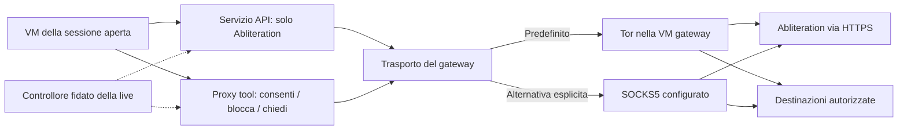

# Oblivion — studio di networking e trasferimento file

24 ottobre 2026. Documento di progettazione collegato al [piano principale](../../PLAN.md). Il [primo broker API](API-BROKER.md) è implementato e provato come componente separato con traffico sintetico sul Mac e in Debian ARM. Il [laboratorio Mac con due VM](NETWORK-LAB.md) prova firewall, Tor reale e guasti sintetici. La [rete della sessione](SESSION-NETWORK.md) collega il guest al broker con token locale e revoca; [stato e bootstrap Tor](TOR-STATE.md) sono integrati. Le [chiavi multiple](CREDENTIALS.md) sono implementate; il nuovo [trasporto Tor/SOCKS](transport-vm-evidence.json) supera 21 casi nelle VM di laboratorio. I [profili nel manager con LUKS](host-lifecycle-ci-evidence.json) superano 28 controlli. Il [ciclo completo aggiornato](ephemeral-evidence.json) verifica anche cambio Tor↔SOCKS con Tor offline, proxy dei tool con client compilato e stream effimeri. Restano Tor online nel percorso completo, isolamento dei flussi tool, trasferimenti e provider reale. Le proposte non autorizzano la pubblicazione di documenti, l'apertura di servizi di rete esterni o la formattazione di dispositivi.

**Vincoli già decisi**

La USB ha un volume LUKS2 generale, con password richiesta all’avvio, che conserva Wi-Fi, API key Abliteration, impostazioni e i file contenitore delle sessioni. Ogni sessione persistente ha una VM e un volume LUKS2 interno indipendenti, con propria password e chiave. Aprire il generale non apre le chat, e il profilo non ne conserva password o chiavi di sblocco. Una sola sessione può essere aperta; il passaggio A→B richiede la chiusura completa di A. Nessun filesystem è condiviso tra sessioni o montato contemporaneamente da live e guest. Ogni istanza OpenCode ha server, database, home, temporanei e processi propri. Si mantengono TUI e strumenti upstream. Il provider è soltanto Abliteration, con più chiavi nominate nel generale e una selezionata prima dell’apertura. Il percorso Internet predefinito è Tor; l’utente può scegliere un SOCKS5 globale, senza fallback tra percorsi né uscita diretta. OnionShare è scelto per la condivisione remota di file, con integrazione CLI nella TUI e ambiente dedicato senza filesystem condivisi. La live e il suo controllore restano fidati.

Il servizio di trasferimento e il gateway sono componenti infrastrutturali, non ulteriori sessioni di chat. Non montano né il volume generale né i volumi delle sessioni. Il controllore della live fornisce loro solo i dati operativi necessari tramite canali ristretti; il gateway e il servizio API non possono esplorare il profilo salvato. Un trasferimento è una copia di byte autorizzata e limitata, non un mount remoto, una sincronizzazione continua o un permesso di esplorare altri ambienti.

**Proposta di rete: due controlli distinti**

La rete deve imporre sia il percorso scelto, Tor o SOCKS5, sia le autorizzazioni sulle destinazioni. Usare un proxy non basta a decidere quali siti possano essere contattati. Il modello di separazione tra workstation e gateway di [Whonix](https://www.whonix.org/wiki/Design) è un riferimento; il proxy con policy di Oblivion richiede progettazione e prove proprie.

Il servizio API e il proxy sono processi distinti nel dominio del gateway, con privilegi minimi e stato della sessione in RAM. La loro precisa collocazione va validata nel prototipo. La VM della sessione ha soltanto una rete privata verso i servizi ammessi; nessun bridge verso la LAN, seconda scheda NAT, accesso al router fisico o inoltro generico. Le regole esterne al guest bloccano ogni altra uscita, anche se la shell ignora le variabili proxy o il guest modifica il proprio firewall.

La VM non può raggiungere il SOCKS Tor o quello esterno senza policy, il ControlPort di Tor, l'amministrazione del gateway o il monitor dell'hypervisor. I canali di gestione dalla live sono separati dal traffico dell'agente. Un guasto del proxy, di Tor o del gateway produce un errore e interrompe le connessioni; non abilita un altro percorso. Il cambio esplicito richiede sessioni e trasferimenti chiusi e fine verificata del gateway precedente.

| Traffico                                                                | Comportamento proposto                                                                                                                                                       |
| ----------------------------------------------------------------------- | ---------------------------------------------------------------------------------------------------------------------------------------------------------------------------- |
| Inferenza, titoli, compaction e altre chiamate AI                       | Servizio API con origin fisso `https://api.abliteration.ai`, endpoint e modelli ammessi; poi il trasporto selezionato e TLS verificato                                       |
| Webfetch, ricerche e connessioni dei tool                               | Proxy con regole per destinazione e porta; nessun contatto esterno finché la regola non consente                                                                             |
| DNS del guest                                                           | Nessuna uscita DNS libera; il proxy risolve attraverso il trasporto selezionato dopo l'autorizzazione. Una risoluzione autonoma del guest fallisce nel prototipo restrittivo |
| IP letterali, indirizzi privati, loopback remoto, link-local e metadata | Rifiutati dal profilo iniziale; eccezioni ristrette solo per servizi interni e per l’endpoint SOCKS configurato                                                              |
| UDP, QUIC e protocolli non supportati                                   | Rifiutati; nessuna conversione in uscita diretta                                                                                                                             |
| Connessioni in ingresso                                                 | Nessuna porta della VM di chat esposta. Un servizio di scambio remoto richiede un componente dedicato e un'operazione dell'utente                                            |
| Aggiornamenti, download di modelli, plugin e telemetria                 | Nessun accesso automatico ereditato da upstream; eventuale manutenzione nel percorso scelto, amministrata a sessioni chiuse                                                  |

Proxy esplicito e compatibilità dei tool sono una scelta da misurare. Impostare le variabili proxy aiuta i client compatibili ma non costituisce la protezione: i client che le ignorano devono fallire. Se uno strumento richiede DNS autonomo o TCP trasparente, occorre un'integrazione che mantenga la stessa policy, non un'eccezione che apra tutto il trasporto. Preservare il toolset non significa garantire il funzionamento di qualunque comando di rete.

La revisione del sorgente v2 corrente trova `webfetch` in
`packages/core/src/tool/plugin/webfetch.ts`: usa il servizio `HttpClient`
iniettato; il client globale corrispondente usa `FetchHttpClient.layer` in
`packages/util/src/effect/app-node-platform.ts`. Non contiene un
client SOCKS autonomo. La [documentazione Bun](https://bun.sh/docs/runtime/networking/fetch)
descrive proxy HTTP tramite ambiente o opzione `proxy`, con CONNECT per HTTPS
e richieste proxy HTTP per destinazioni HTTP. Questo identifica il punto di
integrazione; il comportamento del binario fissato a Bun 1.4.4 è ora
verificato nel [ciclo completo sul Mac](ephemeral-evidence.json), redirect compresi.
Il launcher `conversation.sh` ora esporta `HTTP_PROXY`, `HTTPS_PROXY`,
`ALL_PROXY` e le varianti minuscole verso `10.88.0.1:8112`, con username
`oblivion-tools` e il solo token locale revocabile. `NO_PROXY`/`no_proxy`
escludono loopback e `10.88.0.1:8111`, così server locale e broker conservano
i loro percorsi. Le credenziali del proxy esterno restano fuori da ambiente
e filesystem del guest. Il firewall è il confine anche per programmi che
cambiano o ignorano queste variabili.

Passa la prova con OpenCode compilato e provider sintetico esterno:
sei chiamate agli strumenti reali per HTTP, HTTPS, redirect a dominio vietato,
dominio sconosciuto, porta non ammessa e programma Python lanciato dalla shell.
La fixture controlla risultati, credenziali e assenza di contatti non ammessi;
la sessione B rifiuta poi le destinazioni autorizzate solo per A.
Il solo subprocess di prova aggiunge il certificato pubblico della fixture
tramite `NODE_EXTRA_CA_CERTS`; non si disabilita la verifica TLS e non cambia
la fiducia dell'immagine di produzione. Due test nativi della fixture passano
con socket e TLS reali. Il [primo tentativo Bun/OpenCode nelle VM](compiled-tools-attempt.json)
fallisce con exit 1 durante il subprocess degli strumenti. L'assert riportava
solo stderr, vuoto, senza il JSON su stdout. I nuovi diagnostici identificano
un [assert errato sui messaggi dei tool bloccati](compiled-tools-diagnosis.json).
Corretto l'assert e verificati gli stati JSON reali, il ciclo supera 29 controlli.
Il driver conserva stdout sintetico limitato e la posizione degli errori della
fixture; non aggiunge registrazione al client o al gateway di produzione.

La prova host acquisisce anche una cattura esterna della prima apertura di A,
dalle richieste iniziali fino alla revoca e chiusura. Solo il driver di
laboratorio attiva `filter-dump` tramite il QMP privato; nessuna opzione di
cattura è aggiunta al controller o al launcher di produzione. Prima di
esportare il PCAP sintetico, chiude il filtro e verifica che non contenga
la chiave API o il token locale in chiaro. Il runner richiede esclusivamente
TCP verso il SOCKS configurato, senza DNS/UDP, IPv6 o frammenti IP, e conserva
il PCAP con il suo hash. La cattura delle VM sul Mac contiene 438 pacchetti,
di cui 436 TCP sul solo SOCKS configurato, senza UDP, IPv6 o frammenti IP.
Questa finestra non copre le aperture successive, incluse quelle effimere, o Tor.

**Motore delle regole: prima implementazione.**
`packages/oblivion-transport/src/policy.rs` definisce il formato versionato e
la decisione pura, riusabile da host e gateway. Accetta al massimo 128 regole
per destinazione e porta, globali oppure associate all'identificatore opaco
di una sessione. L'ordine non cambia l'esito: `deny` prevale su `ask`, che
prevale su `allow`; senza corrispondenze l'esito è `ask`, senza autorizzazione
implicita. `*.example.com` include i sottodomini, non l'apice o nomi con un
semplice suffisso simile. Versioni, campi, azioni e ambiti invalidi sono errori.

I nomi ASCII vengono normalizzati; IDN devono arrivare in forma punycode.
URL, credenziali nell'authority, escape, IPv4 abbreviati/ottali/esadecimali,
zone IPv6 e nomi locali sono rifiutati. Gli IP ordinari possono avere regole
esatte; wildcard e CIDR non sono accettati per gli IP. Le esclusioni coprono
i registri special-purpose [IPv4](https://www.iana.org/assignments/iana-ipv4-special-registry)
e [IPv6](https://www.iana.org/assignments/iana-ipv6-special-registry), anche le
eccezioni infrastrutturali globalmente raggiungibili, oltre a multicast e
IPv6 fuori da `2000::/3`. Questa è una scelta restrittiva del prodotto;
non è una verifica dell'indirizzo risolto dal proxy remoto.

Passano nove test dedicati sul Mac e in Debian ARM/x86, insieme ai 19 test host
precedenti; passa anche Clippy sul Mac. La [CI del motore puro](network-policy-ci-evidence.json)
supera tutti i 25 job. La funzione non esegue DNS né apre socket.

Il successivo collegamento al [connettore](EGRESS-CONNECTOR.md) supera i test
di componente in Debian ARM64: un ruolo `oblivion-tools`, abilitato soltanto da configurazione
privata esplicita, verifica sessione, destinazione e porta prima di contattare
il trasporto. `ask` e `deny` chiudono la richiesta; soltanto `allow` inoltra.
La configurazione privata è limitata a 128 KiB e la policy a 128 regole.
Il supervisore accetta questa configurazione nel grant privato. Il modulo `oblivion-gateway::tools` implementa ora il
proxy HTTP/CONNECT come componente, compilato e verificato in Debian ARM64: Basic
con token locale, verifica dell'authority e dell'header Host, rimozione degli
header riservati al proxy, streaming senza file intermedi e revoca anche dei
tunnel già passati a CONNECT. Otto nuovi test passano con socket reali e un
connettore sintetico; le [evidenze](tools-proxy-component-evidence.json) riportano
anche il precedente errore di import corretto e le verifiche VM ancora pendenti.
Il servizio, l'avvio dal supervisore e il firewall superano ora
[quattro scenari completi nelle VM](tools-vm-evidence.json), con 13 controlli
ciascuno: HTTP e CONNECT/TLS, separazione delle credenziali, rifiuti prima
del SOCKS e stream chiusi alla revoca o al crash. Tutti i 29 job CI passano.
Il client è Python: la compatibilità Bun/webfetch resta da verificare.
La revoca dell'intero grant continua a interrompere tutte le sue connessioni.

**Regole nel manager host: implementate e verificate in Linux.**
`W` apre il menu separato dalla chat: aggiunta/sostituzione per destinazione,
porta e ambito, rimozione della regola selezionata e ritorno al profilo salvato.
Il salvataggio persiste tutte le regole attualmente selezionate, incluse
eventuali modifiche temporanee, in `profile/network-policy.json` dentro il
generale LUKS2, root 0600. Una scelta temporanea usa soltanto `/run/oblivion`
e termina al blocco del generale; non è un permesso monouso né a scadenza.
Le modifiche sono vietate a sessione aperta. In readonly si può soltanto
selezionare in RAM. Il controller passa policy e identità opaca della sessione
al grant; il guest non può modificarle. Senza profilo il proxy resta spento;
un profilo esplicito vuoto lo attiva senza autorizzare destinazioni.

Il formato rifiuta campi sconosciuti e un profilo salvato corrotto non viene
nascosto da una selezione temporanea. Scrittura atomica e staging privato
mantengono la versione precedente se il disco è pieno. I 13 test delle regole
passano sul Mac e in Debian ARM/x86, e Clippy sul Mac. Le [prove host](host-policy-evidence.json)
superano 33 controlli storage/manager e 23 del ciclo completo: menu, file cifrato,
staging, disco pieno, readonly e attivazione dal controller. Tutti i 29 job CI
passano. Il probe del grant usa Python per verificare i rifiuti; la nuova prova
dei tool Bun e delle destinazioni consentite resta separata e pendente.
Conferme interattive, scadenze e revoca di singoli permessi restano da implementare;
`ask` continua a bloccare.

**Servizio API e significato delle autorizzazioni**

L'adapter nativo di OpenCode rimane il client. Il suo endpoint viene configurato verso il servizio locale ristretto, che aggiunge la API key soltanto nella richiesta al provider. Il guest non riceve la chiave reale; token locali vengono limitati alla sessione e revocati alla chiusura. Il servizio controlla modelli, endpoint, dimensioni e opzioni consentite, gestisce streaming e cancellazione, e rifiuta redirect verso altre origini. Non è un proxy HTTP generico.

La documentazione di [Abliteration](https://abliteration.ai/data-handling) dichiara assenza di conservazione dei contenuti per l'inferenza, ma conservazione di metadati operativi; ricerca e fetch eseguiti dal provider possono inviare query e URL a terzi. Perciò la proposta iniziale disabilita quelle feature nelle richieste API. Le ricerche degli strumenti OpenCode sono un percorso distinto, sottoposto alle regole del proxy. Il nostro gateway non vede né governa le connessioni avviate dai server di Abliteration. Queste sono dichiarazioni del provider, non una nostra verifica della sua infrastruttura.

Per un dominio sconosciuto la UI fidata può offrire: rifiuta, consenti per questa operazione, consenti fino alla chiusura. La decisione riguarda destinazione e porta effettive richieste al proxy; la descrizione del modello non è un'autorità. Una decisione non completata scade senza inviare traffico alla destinazione, inclusa la sua risoluzione DNS. Le richieste in attesa hanno quote e timeout. Revocare un permesso chiude anche i tunnel già aperti e scarta le richieste accodate.

Le regole da ricordare si salvano nel profilo del volume LUKS2 generale, con ambito globale o per identificatore opaco della sessione; i permessi temporanei restano in RAM e scadono. Solo la UI fidata può modificare il profilo. La sola API key selezionata viene letta dal controllore dopo lo sblocco generale e consegnata al solo servizio API, senza esporre un filesystem condiviso. Una copia delle regole nel disco controllato dal guest non è una fonte fidata. Nell’avvio effimero il generale è accessibile solo in lettura: nuove impostazioni e autorizzazioni non vengono salvate.

Un proxy CONNECT/SOCKS con TLS opaco può limitare la destinazione di connessione richiesta, ma non può garantire URL, metodi, contenuti o servizio applicativo scelto dietro un endpoint condiviso. Non basta confrontare SNI, hostname o IP per dimostrare l'origine applicativa in ogni caso. Non promettiamo che autorizzare un sito impedisca all'agente di inviargli dati. Per il provider possiamo controllare il protocollo perché terminiamo localmente il servizio API; per il traffico generico non prevediamo intercettazione TLS. Un controllo più preciso del web richiederebbe un servizio fetch applicativo separato, da valutare senza attribuirgli protezione universale dall'esfiltrazione.

La risoluzione deve avvenire nel percorso controllato, con rifiuto degli indirizzi riservati e test contro rebinding. In modalità Tor il proxy deve verificare l'indirizzo effettivamente usato o utilizzare e validare i controlli equivalenti di Tor: un controllo DNS preliminare seguito da una risoluzione indipendente non basta. Un SOCKS esterno arbitrario non attesta l’IP finale: il [profilo SOCKS](KEYS-AND-EGRESS.md) distingue la policy sui nomi e gli IP espliciti dai controlli che richiedono fiducia e configurazione del proxy remoto. Per i redirect, ogni nuova destinazione necessita della propria autorizzazione; nel servizio API il comportamento iniziale è rifiutarli. Il comportamento di domini condivisi e onion va verificato prima di dichiarare una policy affidabile.

**Metodo dell'audit di rete.** Le prove devono combinare cattura PCAP sulle interfacce del guest (incluso loopback), tracing delle connessioni per processo e osservazione applicativa nel broker di laboratorio. Una cattura esterna al gateway vede soprattutto Tor e non rivela le destinazioni richieste dal guest; una chiamata bloccata dal kernel può non generare pacchetti. HTTPS non rende visibili URL completi, header e body a un semplice sniffer: la [documentazione Wireshark TLS](https://wiki.wireshark.org/TLS) descrive la decifratura con segreti di sessione quando il runtime la supporta. Nel laboratorio si può usare una fixture o un proxy di ispezione con fiducia limitata al guest di test; non si disabilita globalmente la verifica TLS e non si introduce l'intercettazione generica nel prodotto.

La matrice deve coprire avvio e inattività, chat e tool, titoli/compaction, allegati, webfetch/search e redirect, installazioni/plugin/MCP, editor/parser, errori/retry, cambio sessione e chiusura. Ripetere con cache vuota e calda e con rete/gateway/Tor/SOCKS indisponibili, credenziali proxy errate e cambio percorso, includendo IPv4/IPv6, DNS, UDP/QUIC e connessioni dei figli. Per ogni flusso registrare durante il laboratorio: processo/funzione, destinazione, protocollo, trigger, dati trasmessi e decisione keep/disable/ask. Il criterio finale è default deny con sole eccezioni motivate; un elenco di richieste osservate non dimostra assenza di altri percorsi.

I PCAP, eventuali segreti TLS e body sono artefatti sensibili di sviluppo: si usano dati sintetici e chiavi di test, non chat o credenziali reali, e nessuno sniffer o registro delle richieste rimane abilitato nell'immagine distribuita. La cattura isolata aggiunta agli script di fase 0 è il primo campione riproducibile; non completa la matrice di traffico reale.

**Tor, cambio sessione e infrastruttura**

Tor offre isolamento dei flussi tramite listener distinti o credenziali SOCKS differenti con `IsolateSOCKSAuth`. Queste credenziali identificano gruppi di isolamento: non sono un'autenticazione che sostituisce la policy del gateway. `ClientRejectInternalAddresses` e `ClientDNSRejectInternalAddresses` sono controlli da mantenere e provare. Riferimento: [manuale Tor](https://manpages.debian.org/testing/tor/tor.1.en.html).

La proposta usa gruppi distinti per API, tool e trasferimenti, rinnovati al cambio della sessione. Il gateway può restare acceso finché il profilo generale è sbloccato, ma deve eliminare token, autorizzazioni temporanee, connessioni e dati applicativi della sessione chiusa. Le regole salvate e le API key cifrate rimangono nel profilo; per la nuova sessione il controllore assegna nuovi accessi limitati. Non si conserva una cronologia di destinazioni, richieste o contenuti. Cambiare circuito non garantisce un nuovo IP e non separa identità collegate dalla stessa API key, account, cookie o documento.

Lo stato delle guardie Tor non viene cancellato automaticamente a ogni cambio chat. Il profilo infrastrutturale è ora nel LUKS2 generale e può conservare Wi-Fi, bridge e lo stato operativo Tor necessario, senza cronologia delle destinazioni. Il gateway ne riceve una copia operativa in RAM: formato, campi ammessi e sincronizzazione attraverso il controllore devono essere verificati sulla versione scelta. Nell’avvio effimero il generale viene aperto in sola lettura prima di avviare la rete; il gateway può usare lo stato salvato ma non persistirne modifiche. Questo evita scritture nel profilo, mentre il compromesso sulle guardie tra riavvii rimane da valutare.

Wi-Fi, DHCP, bootstrap Tor o connessione all’endpoint SOCKS, eventuali bridge e sincronizzazione dell'ora richiedono un piano del traffico infrastrutturale. La scelta globale si applica al traffico Internet applicativo: il trasporto deve poter raggiungere soltanto la propria infrastruttura. Le eccezioni infrastrutturali appartengono a servizi fidati, senza possibilità per il guest di usarli come proxy generici. Captive portal, bridge e IPv6 vanno provati; se non supportati, la connessione fallisce con un errore esplicito. Nessuna apertura automatica di un browser esterno per rendere funzionante una chat.

Prima dello sblocco generale non si caricano credenziali né si avviano servizi che usano il profilo. «Chiudi sessione» revoca gli accessi di quella chat ma lascia disponibile il pannello. «Blocca Oblivion» ferma anche i trasferimenti e i servizi di rete, rimuove le copie operative dei segreti e chiude il volume generale per ultimo. Nessuna sessione viene riaperta automaticamente quando si sblocca il profilo.

**Un solo servizio per copiare file, nessuna cartella condivisa**

Il [motore di copia iniziale](FILE-COPY.md) è ora implementato in
`packages/oblivion-transfer`: offerta limitata, selezione di file/cartelle,
stream con hash e ricezione in una transazione privata nuova. Rifiuta link,
percorsi esterni e sovrascritture; le prove usano filesystem e socket reali.
Gli endpoint con conferma, deadline e ricevuta sono ora provati fra VM con
porte virtio-serial, sorgente virtuale readonly e destinazione LUKS. Il relay
Linux lega le due porte ai processi QEMU e interrompe la copia su annullamento
o morte della VM; la prova comprende il suo binario compilato. Il controller e il manager collegano ora l’importazione alla sessione attiva:
selezione della sorgente, percorso relativo, revisione del manifest e conferma.
La copia verificata diventa disponibile in `/vault/imports/<id>/files`, con
un ricevitore distinto dalla chat. Il menu Copie della sessione riconcilia
ricevute persistenti e tentativi privati, con eliminazione soltanto dopo
conferma esplicita. Non ripete automaticamente importazioni e conserva i
file già esposti alla chat. Restano export, dispositivi fisici e guasti I/O;
i flussi seguenti descrivono l’obiettivo completo.

Proponiamo nella UI fidata le operazioni Importa, Esporta e Copia in un'altra sessione. Invia con OnionShare e Ricevi con OnionShare sono operazioni distinte, avviate dall'utente e inizialmente disponibili solo in modalità Tor; un SOCKS generico non sostituisce i servizi onion. Sono funzioni dell'ambiente Oblivion; gli strumenti dell'agente restano quelli di OpenCode.

Il controllore assegna una capacità monouso con sorgente, destinazione, limiti e scadenza. Un protocollo ristretto trasporta nomi relativi, dimensioni e byte su un canale locale, per esempio virtio-serial o vsock; il trasporto definitivo richiede una prova. Il ricevitore sceglie la directory di destinazione e impedisce sovrascritture arbitrarie. Non si passano comandi shell, percorsi host liberamente scelti o handle dell'intero vault. Una capacità viene revocata su annullamento, blocco e cambio sessione.

Il sistema di copie tra qube di [Qubes OS](https://doc.qubes-os.org/en/latest/user/how-to-guides/how-to-copy-and-move-files.html) è un riferimento per il trasferimento tramite protocollo senza montare il filesystem della sorgente nella destinazione. È un principio da studiare, non codice già integrato né equivalenza di sicurezza con Qubes.

Ogni copia entra prima in una directory di ricezione separata. Nel guest persistente anche i file parziali sono sul suo volume LUKS; nell'effimero sono in RAM. Il destinatario conferma dimensione e hash a trasferimento completato prima di rendere disponibile la copia finale. Un hash verifica che i byte corrispondano, non che un documento sia innocuo. Inizialmente si accettano file regolari e directory; link, dispositivi, socket, attributi speciali e percorsi fuori dalla destinazione vengono rifiutati. Gli archivi compressi entrano come file e non vengono estratti automaticamente.

La UI distingue una selezione candidata dalla copia completata. Per export e pubblicazione si prepara una copia stabile nell'ambiente di trasferimento, poi l'utente conferma quella versione: successive modifiche dell'agente al file originale non devono cambiare silenziosamente ciò che viene inviato. Non si cancellano originali automaticamente e non si chiama «spostamento» una copia incompleta.

**USB esterna → sessione**

1. Inserimento della USB: nessun automount nella live o nella VM della chat. Il controllore identifica il dispositivo e l'utente lo seleziona.
2. Avvio di un ambiente di importazione temporaneo, senza rete. Riceve soltanto il dispositivo o la partizione autorizzata, in sola lettura per l'importazione.
3. Elenco dei file e selezione nella UI fidata. I nomi ricevuti sono dati non fidati da validare e renderizzare senza interpretare sequenze di controllo.
4. Trasferimento dei soli file selezionati al ricevitore della sessione. Nessun mount della USB o del filesystem di importazione nella VM della chat.
5. Conferma della copia, disponibilità dei documenti nel workspace e distruzione dell'ambiente di importazione.

Gli originali sulla USB restano invariati e mantengono la loro protezione originale. Una USB non cifrata non viene cifrata dall'importazione. I file grandi possono essere copiati in streaming nel volume della sessione senza mantenerli interamente in RAM. Parser di documenti e anteprime non girano nel controllore; leggere un file come contesto non deve caricare automaticamente plugin, skill o configurazioni presenti nella sorgente.

L'isolamento del filesystem esterno riduce l'esposizione dei suoi parser, ma non elimina l'esposizione del sistema live allo stack USB quando si collega il dispositivo. Isolare il controller USB richiede supporto hardware e un progetto ulteriore; [Qubes documenta questa distinzione](https://doc.qubes-os.org/en/latest/user/security-in-qubes/device-handling-security.html). Non presentiamo il semplice passthrough come protezione completa da dispositivi USB ostili.

L'esportazione segue il percorso inverso, con un ambiente autorizzato a scrivere sulla destinazione selezionata. La UI indica se produce una copia ordinaria leggibile. Il completamento richiede flush, conferma del ricevitore e smontaggio prima di suggerire di rimuovere il supporto. La VM della chat non riceve accesso in scrittura alla USB.

**Sessione A → sessione B senza aprirle insieme**

1. Con A aperta, l'utente seleziona i file. Il servizio riceve una copia limitata e stabile nel proprio deposito temporaneo, non montato in A.
2. A viene chiusa completamente. Se la chiusura fallisce, B non viene aperta.
3. L'utente sblocca B e conferma l'importazione; il servizio invia la copia al ricevitore di B.
4. A conferma della ricezione o su annullamento, il deposito viene scartato. Non rimane una cartella di scambio permanente.

Per il primo prototipo il deposito è in RAM, con limite esplicito. Per file oltre tale limite, studiare uno spazio temporaneo cifrato con una chiave casuale conservata soltanto in RAM dal servizio e distrutta a fine operazione; non usare la chiave di A o di B. Questo deposito di servizio non è un secondo volume di sessione aperto e non viene montato nei guest. Finché il meccanismo non è pronto, un trasferimento troppo grande viene rifiutato. Nell'effimero resta obbligatorio usare soltanto RAM.

Durante il trasferimento una copia autorizzata esiste dunque fuori dal vault sorgente, sotto controllo del servizio. Il solo divieto di filesystem condivisi non implica assenza di copie: questo passaggio deve essere esplicito. Spegnimento o crash del servizio possono rendere irrecuperabile la copia temporanea; l'originale in A rimane. Non promettere cancellazione fisica certa della flash: lo smaltimento della chiave e l'assenza di sue copie persistenti sono requisiti distinti da verificare.

**Condivisione remota: OnionShare scelto**

Per inviare o ricevere file da un'altra persona, useremo OnionShare in un ambiente dedicato, con servizi onion temporanei. La scelta del componente è confermata dall'utente; integrazione e protezioni restano da implementare e verificare. [OnionShare](https://docs.onionshare.org/2.6/en/features.html) supporta invio e ricezione attraverso Tor e accesso protetto da una chiave; il destinatario usa Tor Browser e la live deve restare online. Esiste una [interfaccia a riga di comando](https://docs.onionshare.org/2.6/en/advanced.html), quindi l'integrazione non richiede una GUI di chat. La documentazione consultata è quella 2.6: versione effettiva, dipendenze e opzioni CLI vanno fissate e auditate prima dell'integrazione.

Proposta per l'invio: copiare soltanto i documenti confermati nell'ambiente di trasferimento, creare un servizio a tempo e mostrarne indirizzo e credenziale nella UI fidata. Revoca, chiusura della sessione o scadenza devono interrompere il servizio e le connessioni. Nessun filesystem della sessione viene pubblicato. Il destinatario può conservare i file già ricevuti: chiudere il servizio non revoca quelle copie.

Per la ricezione: l'utente avvia una finestra di ricezione con quota e scadenza. I file entrano nel deposito isolato; soltanto dopo l'accettazione vengono copiati nella sessione. Niente apertura automatica, webhook, esecuzione di allegati o link permanenti. OnionShare è un trasporto, non una bonifica dei documenti. Il prodotto deve rendere esplicito anche che usare un documento come contesto può inviarne contenuti al provider AI.

L'integrazione deve riusare il percorso Tor amministrato, senza offrire ControlPort generico all'agente o al ricevitore. Un servizio ristretto gestisce creazione e rimozione dei soli onion autorizzati. Le [opzioni di connessione di OnionShare](https://docs.onionshare.org/2.6/en/tor.html) includono bootstrap e richieste esterne per alcune funzioni di aggiramento della censura: non vanno abilitate implicitamente nel nostro profilo. Servono prove di compatibilità con Tor esterno e un audit di log, ZIP temporanei, cronologie, chiavi onion e file di configurazione.

**Prove successive e decisioni ancora aperte**

| Ordine | Esperimento                                                | Evidenza richiesta                                                                                                                                                     |
| ------ | ---------------------------------------------------------- | ---------------------------------------------------------------------------------------------------------------------------------------------------------------------- |
| 1      | VM di sessione → servizio API simulato → proxy controllato | Streaming e tool calling funzionano; guest senza accesso diretto a Internet o API key reale                                                                            |
| 2      | Gateway Tor con policy                                     | DNS, IPv4/IPv6, IP letterali, redirect, tunnel e processi che ignorano il proxy non aggirano le regole; Tor spento blocca tutto il traffico applicativo                |
| 3      | Cambio A→B                                                 | Un solo volume di sessione aperto; connessioni, token e autorizzazioni di A revocati, nessun payload di A inoltrato dopo il cambio                                     |
| 3b     | Profilo generale e blocco globale                          | Wi-Fi, API key e regole ricaricati solo dopo la password generale; nessun auto-unlock delle sessioni o mount condiviso; stop dei servizi prima di chiudere il generale |
| 3c     | Avvio effimero con profilo salvato                         | Volume generale e dispositivo in sola lettura; nessun aggiornamento del profilo, dello stato Tor o dei contenitori; eventuale recovery in scrittura mai automatico     |
| 4      | API reale Abliteration via Tor                             | Endpoint, streaming, errori e compatibilità verificati con credenziale di prova; nessun fallback ad altri provider o a connessione diretta                             |
| 5      | USB → sessione → USB                                       | File sintetici normali e ostili, cartelle, quote, rimozione USB e annullamento; nessun mount condiviso o scrittura involontaria sull'originale                         |
| 6      | A→B                                                        | Copia con chiusura intermedia, interruzioni, perdita del deposito e limite RAM; impossibilità di accedere ad altri file della sorgente                                 |
| 7      | OnionShare isolato                                         | Ingresso e uscita su Tor controllato, nessun accesso al vault, scadenza e revoca, nessun residuo persistente non previsto                                              |

Restano da scegliere il proxy concreto e la compatibilità dei client, il trasporto locale dei file, il formato del deposito cifrato per file grandi, lo schema e il ciclo di vita del profilo amministrativo nel generale e il trattamento dello stato Tor tra avvii. Il percorso minimo da realizzare è prima networking confinato e copia USB→sessione→USB; il trasferimento A→B e la condivisione onion vengono dopo. Questi esperimenti non sostituiscono l'audit di fase 0 già avviato.
